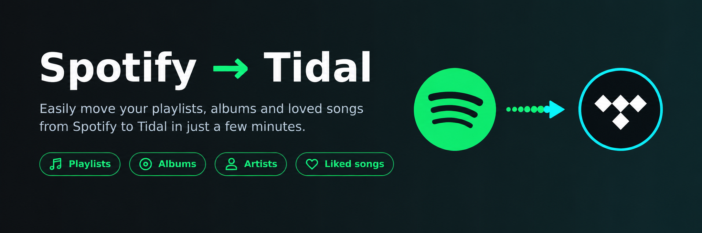
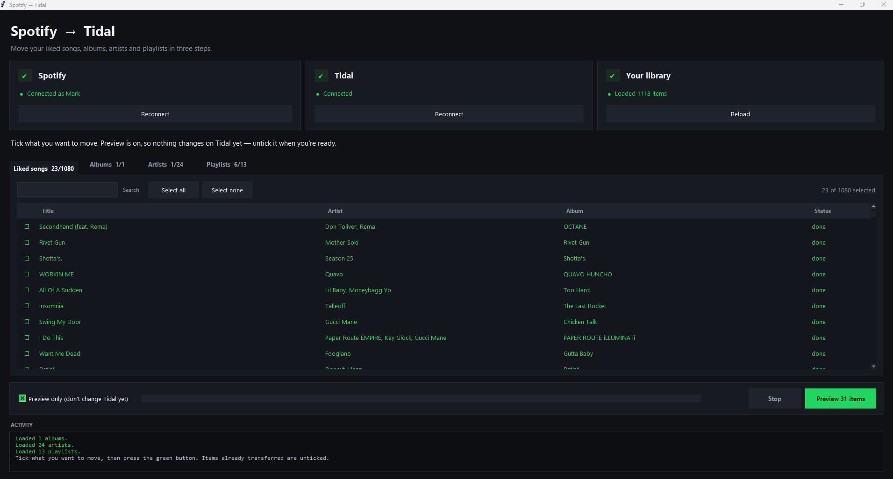
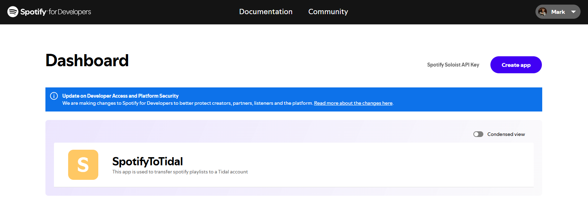
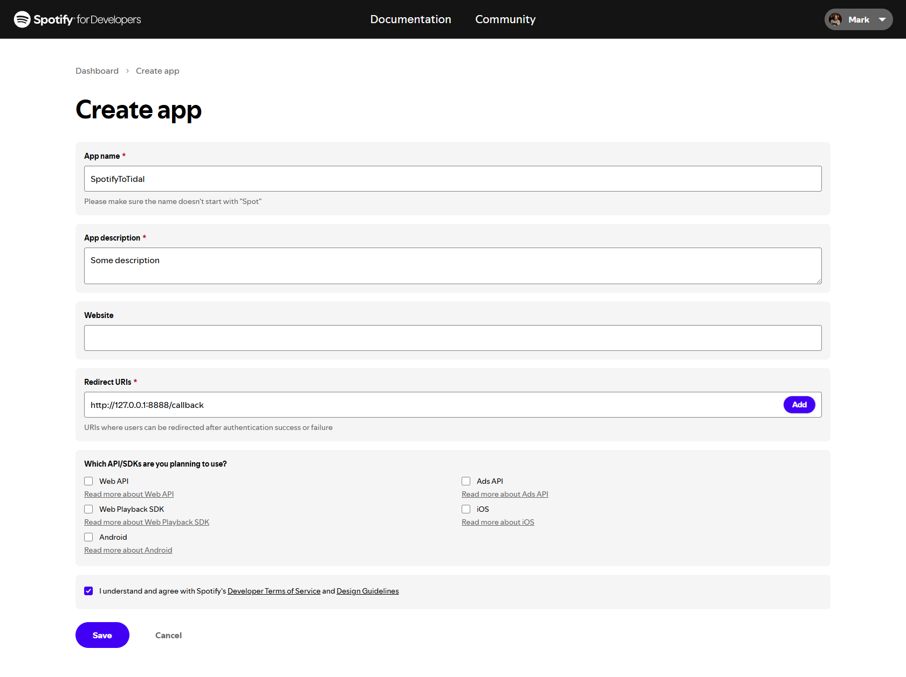
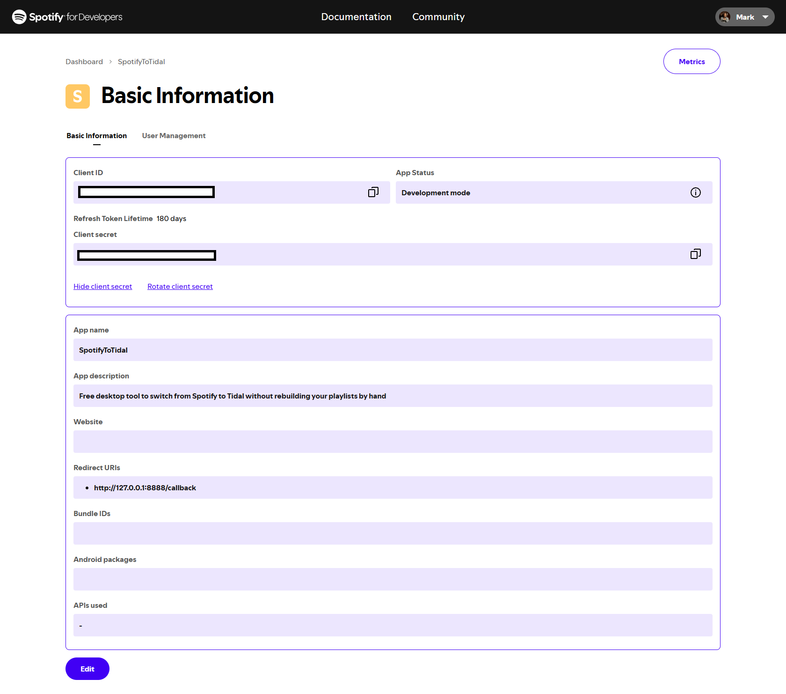
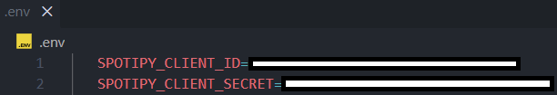
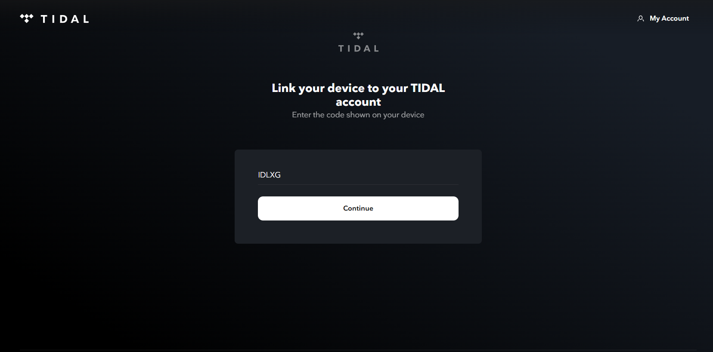
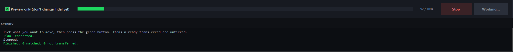

# Spotify → Tidal Transfer

**Move your whole music library to Tidal in minutes, not weekends.**



<!-- Replace docs/images/00-banner.png with your own banner (optional). -->

## Why this exists

Maybe you're tired of Spotify's sound quality and you want to hear your music the way it was recorded. Tidal streams lossless and hi-res audio, so it's tempting.

But something keeps stopping you from switching: **your library**.

Years of liked songs. Hundreds of playlists you built by hand for the gym, the car, studying, road trips and every mood in between. Albums you saved. Artists you follow. Rebuilding all of that on Tidal means searching for every single song, one at a time, and there can be thousands of them. That's what keeps most people locked in.

**This app removes that obstacle.** It reads your Spotify library, finds each song, album and artist on Tidal, and recreates your playlists there, with the same names and the same track order. You choose exactly what moves, you can preview everything first, and it keeps your liked songs in the right order so your most recent like on Spotify is still your most recent on Tidal.

It runs entirely on your own computer. Nothing is uploaded to any third-party service.

## What you get

- A friendly desktop window with three steps: connect Spotify, connect Tidal, load your library.
- **Liked songs, saved albums, followed artists and playlists**, all in one place.
- Tick or untick any item before transferring.
- A **preview mode** that shows what would match without changing anything on Tidal.
- Liked songs keep their order (newest on Spotify = newest on Tidal).
- Fast: Tidal lookups run in parallel.
- Safe to re-run: items already transferred are remembered and skipped.
- Anything that can't be found on Tidal is saved to `unmatched.csv` with its Spotify link.



<!-- Replace docs/images/06-app-connected.png with a screenshot of the app window. -->

## What it can't move

- Listening history and stats (Spotify doesn't let apps export these in a usable way for transfer).
- Podcasts, audiobooks and local files.
- Playlist cover images.
- Songs that simply don't exist on Tidal (they're listed in `unmatched.csv`).
- Some Spotify-made playlists (such as Discover Weekly) may not allow their tracks to be read.

You also need a Tidal subscription that includes the quality you want, and a Spotify account to read from.

## How it works in 30 seconds

1. You create a free "app" on the Spotify developer dashboard (two minutes) to get a key that lets this tool read **your own** library.
2. You run the app, log in to Spotify and Tidal in your browser, and load your library.
3. You tick what you want and press the green button.

## Contents

1. [What&#39;s in this folder](#whats-in-this-folder)
2. [Step 1: Install Python](#step-1-install-python)
3. [Step 2: Open the folder in a terminal](#step-2-open-the-folder-in-a-terminal)
4. [Step 3: Install the libraries](#step-3-install-the-libraries)
5. [Step 4: Create a Spotify app](#step-4-create-a-spotify-app-to-get-your-credentials)
6. [Step 5: Create the `.env` file](#step-5-create-the-env-file)
7. [Step 6: Run the app](#step-6-run-the-app)
8. [Order and speed](#order-and-speed) · [Matching](#how-songs-are-matched) · [Re-running](#re-running-and-whats-remembered)
9. [Terminal mode](#using-the-terminal-instead-of-the-window) · [Troubleshooting](#troubleshooting) · [Privacy](#privacy-and-security)

---

## What's in this folder

| File               | What it is                                                   |
| ------------------ | ------------------------------------------------------------ |
| `gui.py`           | The app with the window. **Start here.**                     |
| `transfer.py`      | The engine (also usable straight from the terminal).         |
| `requirements.txt` | The Python libraries needed.                                 |
| `.env`             | **You create this.** Holds your Spotify credentials.         |
| `docs/images/`     | Screenshots used in this guide (replace them with your own). |

Files the app creates by itself:

| File                  | Purpose                                                 |
| --------------------- | ------------------------------------------------------- |
| `tidal_session.json`  | Your saved Tidal login. **Keep private.**               |
| `.spotify_cache`      | Your saved Spotify login. **Keep private.**             |
| `transfer_state.json` | Remembers what was already transferred.                 |
| `unmatched.csv`       | Items that couldn't be transferred, with Spotify links. |

---

## Step 1: Install Python

You need Python 3.9 or newer. Check by opening a terminal and running:

```
py --version
```

(On Mac/Linux use `python3 --version`.)

If it isn't installed, get it from https://www.python.org/downloads/ and **tick "Add python.exe to PATH"** in the installer. Keep the "tcl/tk and IDLE" option ticked: the window needs it.

> **Windows tip:** if `python` says _"Python was not found; run without arguments to install from the Microsoft Store"_, use `py` instead of `python` everywhere in this guide.

## Step 2: Open the folder in a terminal

In VS Code: **File → Open Folder** and choose this folder, then open the terminal with **Ctrl+`** (or Terminal → New Terminal).

Or in any terminal, go to the folder with `cd`, for example:

```
cd C:\Users\YourName\Desktop\spotify-to-tidal
```

## Step 3: Install the libraries

```
py -m pip install -r requirements.txt
```

(Mac/Linux: `python3 -m pip install -r requirements.txt`.) You only need to do this once.

## Step 4: Create a Spotify app (to get your credentials)

Spotify requires every tool that reads a library to have its own free "app" registration. It takes about two minutes.

1. Go to **[https://developer.spotify.com/dashboard](https://developer.spotify.com/dashboard)** and log in with your Spotify account. (Spotify may ask you to accept the developer terms, and may require the account to be Premium.)
2. Click **Create app**.

   

   <!-- Replace docs/images/01-spotify-dashboard.png: screenshot of the dashboard showing the Create app button. -->

3. Fill in the form:
   - **App name:** anything, e.g. `Tidal Transfer`
   - **App description:** anything, e.g. `Transfers my library to Tidal`
   - **Website:** leave empty
   - **Redirect URIs:** type exactly `http://127.0.0.1:8888/callback` and click **Add**. It must appear in the list under the field.
   - **Which API/SDKs are you planning to use?** tick **Web API**
   - Tick the box agreeing to the terms.

   

   <!-- Replace docs/images/02-spotify-create-app-form.png: screenshot of the filled-in form (name, description, Redirect URI, Web API ticked). -->

4. Click **Save**.
5. Open your new app and go to **Settings**. Copy the **Client ID**, then click **View client secret** and copy that too.

   

   <!-- Replace docs/images/03-spotify-client-id-secret.png: screenshot of Settings showing Client ID and View client secret. BLUR YOUR REAL SECRET before sharing. -->

> The redirect URI must match exactly: `http` (not `https`), `127.0.0.1` (not `localhost`), port `8888`, and no trailing slash. After adding it, make sure you click **Save** at the bottom of the Settings page.

## Step 5: Create the `.env` file

In this folder (next to `gui.py`) create a new file named exactly **`.env`**, and put your two values in it:

```
SPOTIPY_CLIENT_ID=paste-your-client-id-here
SPOTIPY_CLIENT_SECRET=paste-your-client-secret-here
```



<!-- Replace docs/images/04-env-file.png: screenshot of your .env file. HIDE your real values before sharing. -->

Rules:

- No quotes and no spaces around the `=`.
- The file name is `.env`, with the dot at the start and **no** `.txt` at the end. Windows often hides extensions: in File Explorer turn on **View → Show → File name extensions** to check it isn't `.env.txt`.
- It must be in the same folder as `gui.py` and `transfer.py`.
- You don't need to add a redirect URI line; the app always uses `http://127.0.0.1:8888/callback`.
- If you use git, add `.env` to your `.gitignore`. Never share this file.

## Step 6: Run the app

```
py gui.py
```

A window opens. Follow the three cards from left to right. The hint line under them always tells you what to do next.

### 1. Connect Spotify

Click **Connect Spotify**. Your browser opens a Spotify page: click **Agree**. The browser then lands on a page that looks blank or says "connection refused". That's normal. Go back to the app: the card turns green and shows your name.

### 2. Connect Tidal

Click **Connect Tidal**. A browser tab opens with a "Link your device to your TIDAL account" page and a code already filled in. Click **Continue**, log in to Tidal if asked, and approve. Return to the app: the card turns green.



<!-- Replace docs/images/05-tidal-link-device.png: screenshot of the Tidal 'Link your device' page. -->

Your Tidal login is saved in `tidal_session.json`, so next time it connects without a browser. The code expires after a few minutes; if it does, click **Connect Tidal** again.

### 3. Load your library

Click **Load library** and wait (about a minute for a big library). Four tabs fill up: **Liked songs**, **Albums**, **Artists** and **Playlists**.

### 4. Choose what to transfer

- Click the checkbox at the start of a row to tick or untick it (or select a row and press **Space**).
- Use **Search** to filter a tab, then **Select all** / **Select none** to tick or untick everything shown.
- The tab titles show how many items are ticked, e.g. `Liked songs 950/1079`.
- Items already transferred in an earlier run are unticked and marked **done**.
- The **Playlists** tab lists playlists you made and also ones you follow (including Spotify-made ones). Untick any you don't want.

<!-- Replace docs/images/07-app-library.png: screenshot of a tab with ticked rows and statuses. -->

> **Albums tab:** it only lists albums you explicitly saved on Spotify ("Save to Your Library"). Albums you only know through liked songs or playlists don't appear there.

### 5. Preview first, then transfer

1. Leave **Preview only (don't change Tidal yet)** ticked and click the green button (e.g. _Preview 1100 items_). Nothing on Tidal changes. Each row gets a status:
   - green **matched** = found on Tidal
   - amber **no match** = not found
   - red **error** = something went wrong (see the activity log)
2. When you're happy, **untick** "Preview only". The button changes to _Transfer N items to Tidal_. Click it and confirm.
3. Watch the progress bar. **Stop** halts safely and keeps your progress.
4. When it finishes, a summary pops up. Check `unmatched.csv` for anything that wasn't found.



<!-- Replace docs/images/08-app-transfer.png: screenshot of the transfer in progress or finished. -->

Playlists are created on Tidal with the same name, descrisption and track order. Local files and podcast episodes in playlists are skipped.

---

## Order and speed

- **Order:** Spotify shows your newest likes first. The app adds songs to Tidal **oldest first**, so your newest like is added last and appears on top in Tidal's "Date added" view. If Tidal looks reversed, change the sort to **Date added** in the Tidal app.
- **Songs already on Tidal** from before keep their old position.
- **Speed:** lookups on Tidal run 6 at a time, while adds still happen one by one to keep the order exact. If Tidal ever returns rate-limit errors, lower `WORKERS = 6` near the top of `transfer.py` to `3`.

## How songs are matched

- **Songs:** by ISRC (an exact recording ID), falling back to title + artist + length.
- **Albums:** by barcode (UPC), falling back to title + artist.
- **Artists:** by exact name. Common or unusual names may land in `unmatched.csv`.

Not everything exists on Tidal, so a few "no match" results are normal.

## Re-running and what's remembered

- Re-running is safe. Items transferred by this app are recorded in `transfer_state.json` and skipped next time.
- The app does **not** check what's already in your Tidal favorites; it only knows what it transferred itself. Tidal normally ignores a favorite that already exists.
- Re-running a playlist reuses a Tidal playlist with the same name instead of creating a copy.
- To start completely fresh, delete `transfer_state.json`.

---

## Using the terminal instead of the window

```
py transfer.py --dry-run                # preview everything, change nothing
py transfer.py                          # transfer everything
py transfer.py --only tracks            # only one kind: tracks | albums | artists | playlists
py transfer.py --only albums --only artists
```

The first run opens the same Spotify and Tidal logins. This mode transfers everything not yet done; use the window if you want to pick individual items.

---

## Troubleshooting

**`Python was not found; run without arguments to install from the Microsoft Store`**
Use `py` instead of `python`. Or turn off the shortcut under Settings → Apps → Advanced app settings → App execution aliases (switch off the `python.exe` entries).

**`No module named 'tkinter'`**
Reinstall Python from python.org and keep "tcl/tk and IDLE" ticked. On Linux: `sudo apt install python3-tk`.

**`Missing SPOTIPY_CLIENT_ID ...` or a "Missing credentials" popup**
The app can't see your `.env`. The message shows the exact path it looks in. Check the file is named `.env` (not `.env.txt`), is in the same folder as `gui.py`, and has the two lines from Step 5.

**Spotify says `redirect_uri: Not matching configuration` (or `INVALID_CLIENT`)**

- In the dashboard, Settings → Redirect URIs must contain exactly `http://127.0.0.1:8888/callback`, and you must have clicked **Save**.
- The Client ID in `.env` must belong to that same app (check if you have several apps).
- Delete the `.spotify_cache` file and try again.

**The Spotify page after "Agree" looks blank or says "connection refused"**
Normal. Return to the app window; it picks up the login by itself.

**Tidal code is invalid or expired**
Click **Connect Tidal** again and use the new link.

**Many items say "no match"**
Check `unmatched.csv`. Some tracks (region-locked, removed, or exclusive) simply aren't on Tidal. Artists are matched by exact name only, so add those by hand.

**Rate-limit or timeout errors during a transfer**
Lower `WORKERS` in `transfer.py` (see "Order and speed") and run again; progress is saved so it continues where it stopped.

**A playlist shows `error`**
Some playlists (e.g. ones made by Spotify) may not allow reading their tracks. Check the activity log for the reason and untick them.

**It won't connect to Tidal after I changed my password**
Delete `tidal_session.json` and connect again.

---

## Privacy and security

- Everything runs on your own computer. Your credentials only go to Spotify and Tidal.
- `.env`, `tidal_session.json` and `.spotify_cache` give access to your accounts. Don't share them, post them anywhere, or commit them to git. If you've shared one by accident, change that service's password (and for Spotify, regenerate the app's client secret in the dashboard).
- To remove the app's access when you're done: delete those three files, delete the app in the Spotify dashboard, and remove the app under Spotify → Account → Apps.
